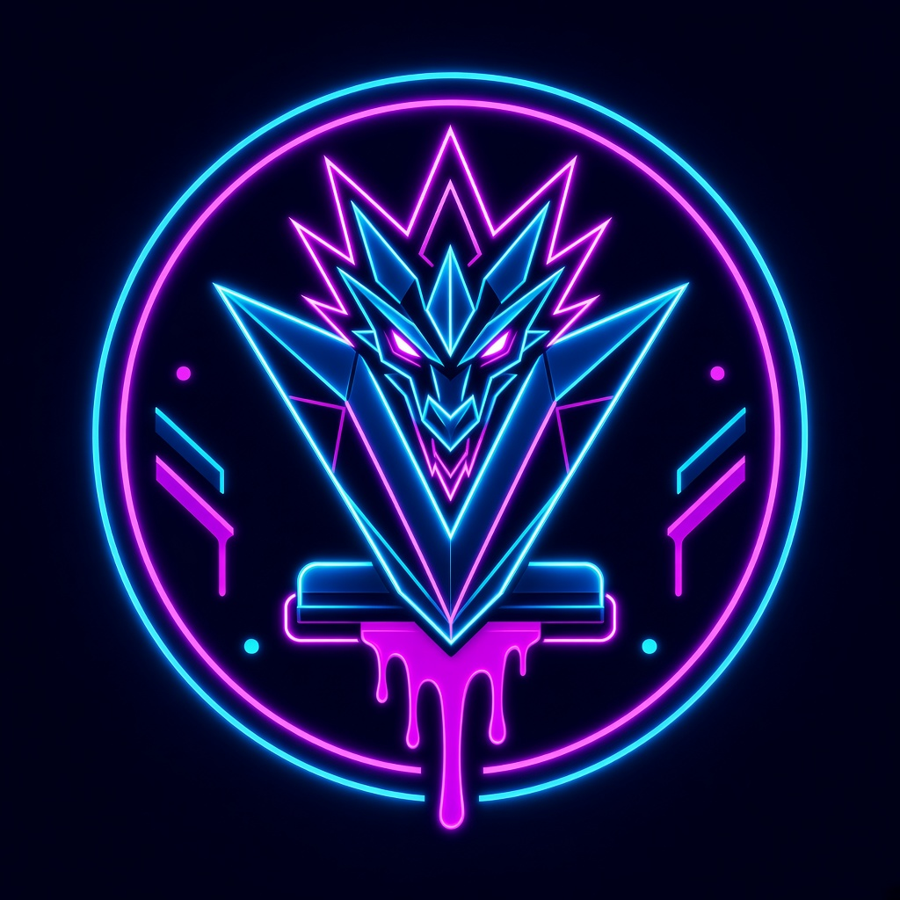
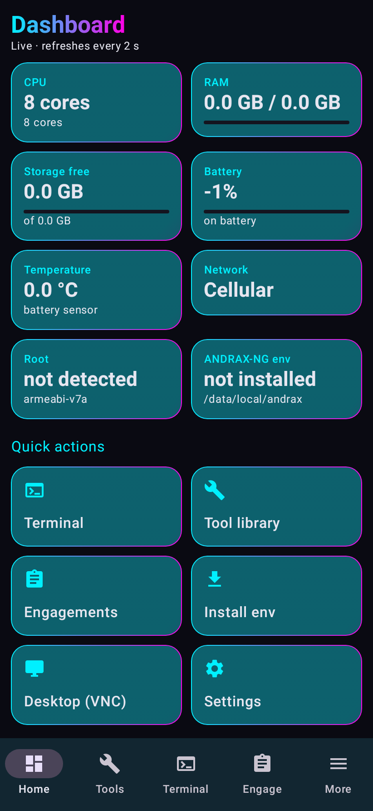
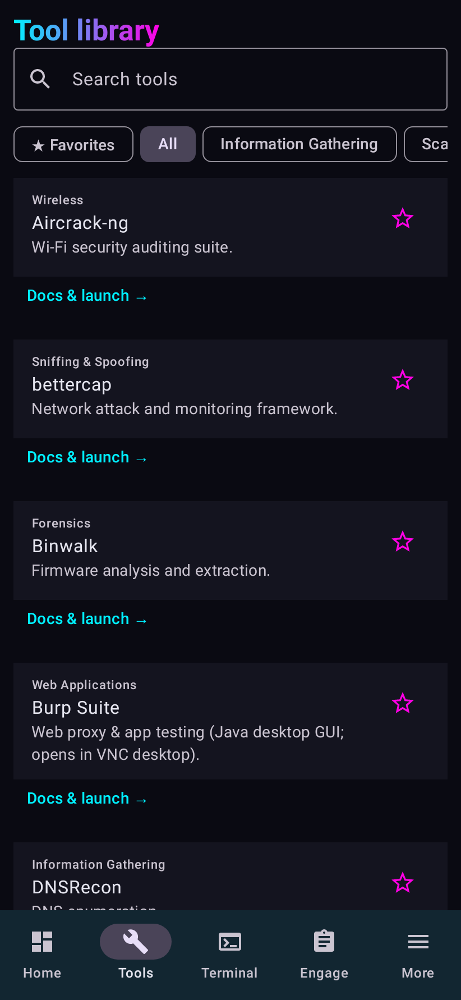
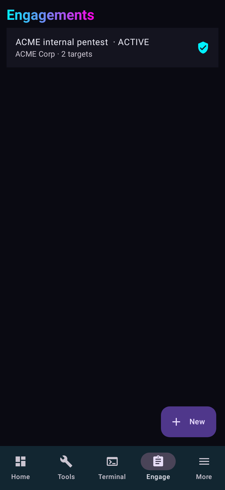
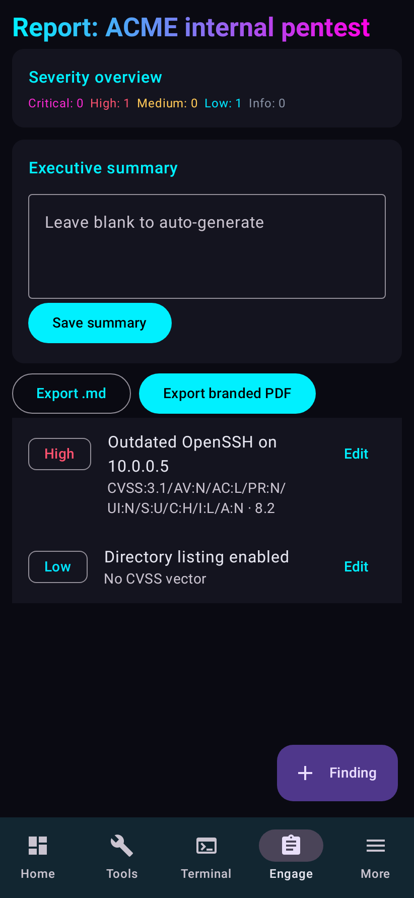
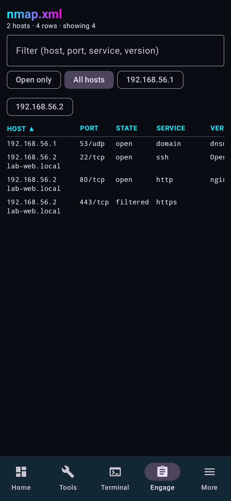

<div align="center">



# VictorDrax

**Set up and drive ANDRAX-NG on Android, with authorization and scope built in.**

<p>
  <a href="https://github.com/Victorious93/victordrax/actions/workflows/android.yml"></a>
  
  
  <a href="https://victorious-framework.pages.dev"></a>
</p>

<p><a href="https://victorious-framework.pages.dev">Victorious Framework</a></p>

</div>

---

An Android app (Kotlin + Jetpack Compose) for setting up and driving the **ANDRAX-NG** penetration-testing environment from [SNAKE Security](https://github.com/snakesec): engagements with recorded authorization, scope-checked tool launches, scan import, findings and reports. Package id: `com.victorious.victordrax`, version 0.2.0.

> ⚠️ **Authorized testing only.** Use this only on systems you own or have written permission to test. The app makes you accept this notice on first launch and keeps it visible in About. All offensive actions are tied to an engagement with a recorded authorization (who, date, document) and a scope; nothing runs against targets outside that scope.

## Features

- **Status and install:** shows root (`su`) detection, CPU architecture and free storage, explains the requirements and links the official upstream sources. *Fully automatic download and setup of ANDRAX-NG is **Planned**.*
- **Engagements and scope:** authorization on record, scope validation and an argv-safe command launcher.
- **Kali Top 10 tool screens:** forms for Nmap, sqlmap, THC Hydra, John the Ripper, Aircrack-ng and OWASP ZAP; a Metasploit resource builder; launch-only Burp Suite, Maltego and Wireshark in the VNC desktop. See [docs/top10-tools.md](docs/top10-tools.md).
- **Scan viewer and network discovery:** import nmap XML (`-oX`, XXE-hardened), grepable (`-oG`), JSON or CSV; sortable, filterable tables and host cards with one-tap "create finding".
- **Workflows:** playbooks with `{variables}` stored in Room; a run needs an authorized engagement and an in-scope target. Built in: Nmap service scan, passive host recon (whois/dig), top-ports TCP sweep.
- **Scan scheduler:** WorkManager with a scope and authorization guard and notifications.
- **Findings and reports:** status, tags, evidence and a CVSS 3.1 calculator; executive summary; branded PDF and Markdown export.
- **BeEF-XSS control panel** and a **MITM proxy console** (`mitmdump` through VictorSuite, with flow import and filters), framed for your own authorized test traffic.
- **afos-ng packages:** browse the bundled catalog and run `afos` install/update inside the ANDRAX-NG chroot via VictorSuite (needs a rooted device with the environment installed).
- **Encrypted backup and restore:** AES-256-GCM with a PBKDF2-HMAC-SHA256 key (210k iterations); merge or replace; a wrong passphrase changes nothing.
- **VNC desktop launcher**, Glance home-screen widgets, and a Shizuku wireless-debugging pairing helper.
- **In-app manual:** More → Manual / Help, a searchable Markdown manual with deep links.

## Screenshots

Rendered headlessly with Robolectric (not on a device). All 19 screens are in [`docs/screenshots/`](docs/screenshots/).

<p align="center">
  
  
  
  
  
</p>

## Install

No release is published yet. Download the debug APK from the latest [Android CI run](https://github.com/Victorious93/victordrax/actions/workflows/android.yml) (`victordrax-debug-apk` artifact). minSdk 26. ANDRAX-NG chroot install and the VNC desktop need **uid 0**: Magisk `su`, or Shizuku via [Sui](https://github.com/RikkaApps/Sui).

## Build from source

JDK 17 and the Android SDK (API 34).

```bash
git clone https://github.com/Victorious93/victordrax.git
cd victordrax
./gradlew testDebugUnitTest assembleDebug
```

The APK lands in `app/build/outputs/apk/debug/`. `keystore/debug.keystore` is a **debug-only** key (passwords `android`/`android`) committed so debug builds share one signature. It is not secret and must never sign a release. No release keys or secrets are in this repository.

## Privilege modes and permissions

**Auto** mode prefers root, then [Shizuku](https://shizuku.rikka.app/) (an elevated-shell backend, not bundled; install it separately and grant permission in Settings), then unprivileged. Declared permissions: `INTERNET`, `ACCESS_NETWORK_STATE`, `POST_NOTIFICATIONS`, `FOREGROUND_SERVICE` (data sync), `com.termux.permission.RUN_COMMAND` and `moe.shizuku.manager.permission.API_V23`.

## Terminal: VictorSuite

VictorDrax has no built-in terminal. "Open terminal" and every tool launch open a session in [VictorSuite](https://github.com/Victorious93/VictorSuite) through its Termux-compatible `RUN_COMMAND` intent, entering the ANDRAX-NG chroot when installed. If VictorSuite has not allowed external apps, VictorDrax opens VictorSuite and copies the command to the clipboard instead. See [docs/victorsuite-integration.md](docs/victorsuite-integration.md).

## Optional root module

A small, optional universal flashable module for Magisk, KernelSU and APatch mounts the chroot at boot. The app works the same without it. See [docs/root-module.md](docs/root-module.md).

## Credits

ANDRAX by Weidsom Nascimento / The Cracker Technology. ANDRAX-NG and afos-ng (Apache-2.0) by SNAKE Security. Not affiliated with SNAKE Security. Upstream files are linked, not copied: see [NOTICE](NOTICE) and [THIRD_PARTY.md](THIRD_PARTY.md).

---

## Victorious fleet

VictorDrax is part of the [Victorious Framework](https://victorious-framework.pages.dev), a family of Android and PC tools by Don Victor. **Every app works standalone; fleet integrations are optional** and never required.

Related: [VictorSuite](https://github.com/Victorious93/VictorSuite) (terminal and Linux environment), [droidcommand-AI](https://github.com/Victorious93/droidcommand-AI) (fleet controller), [victorious-fleet](https://github.com/Victorious93/victorious-fleet) (index of all fleet apps). The full roster lives in [victorious-fleet](https://github.com/Victorious93/victorious-fleet), and live status is in [fleet-manifest](https://github.com/Victorious93/fleet-manifest).

## Contributing

Issues and pull requests are welcome. Keep changes focused, match the existing code style, never commit secrets or release keys, and keep any fleet integration optional so the app still works on its own. Open a PR against the default branch and wait for CI to pass.

## License

Our code is released under the **Apache License 2.0** (the same as afos-ng); see [LICENSE](LICENSE). Upstream attributions are in [NOTICE](NOTICE) and [THIRD_PARTY.md](THIRD_PARTY.md).
